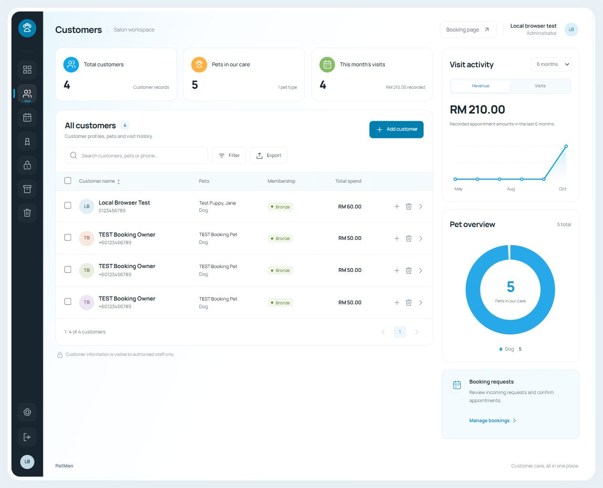
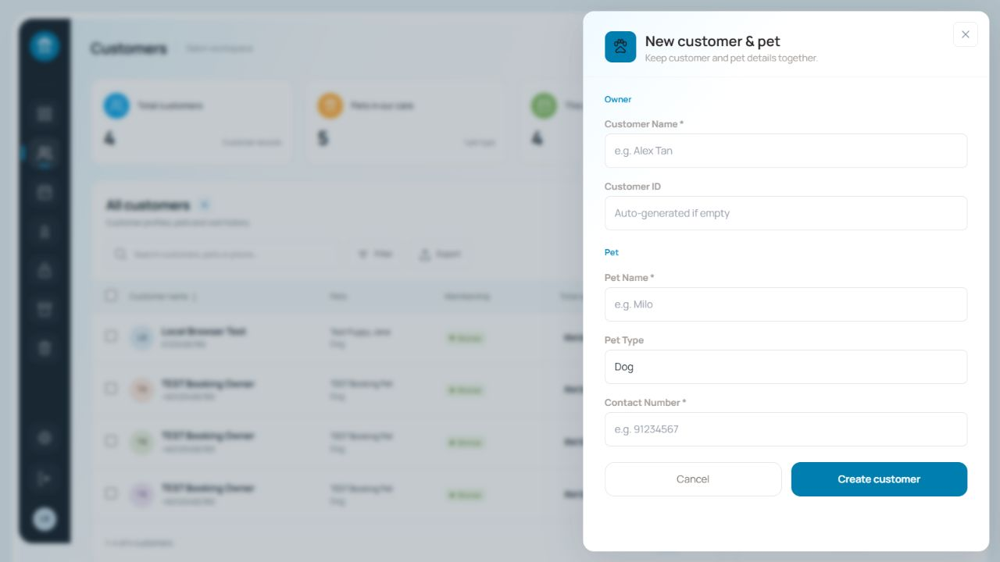

<div align="center">

# 🐾 PetMan

### A little less admin. A lot more time for pets.

Customer records, pet care history, bookings, and memberships — together in one workspace for pet grooming businesses.


[Screenshots](#a-look-inside) · [Features](#made-for-the-daily-routine) · [Get started](#run-it-locally) · [Deployment guide](./CLOUDFLARE.md)

</div>

---

## A look inside

A compact admin workspace with a dark navigation rail, customer tables, visit insights, and side panels that keep everyday tasks close at hand.



<details>
<summary><strong>View the customer & pet entry panel</strong></summary>

Create customer and pet records together without leaving the workspace.



</details>

<sub>Screenshots show local demonstration records.</sub>

## Made for the daily routine

| Area | What you can do |
| --- | --- |
| **Customers & pets** | Keep owner details, pet profiles, care notes, and visit history connected. |
| **Booking requests** | Let customers choose a package, date, and time slot, then submit their details. Staff confirm, cancel, and complete requests. |
| **Memberships** | Track birthdays, marketing consent, spending, membership tiers, and configured discount percentages. |
| **Visit insights** | Review recorded appointment amounts, recent activity, and your pet overview. |
| **Customer portal** | Give customers a login linked to their own records with read-only access. |
| **User management** | Create accounts, manage access, and reset customer passwords from the admin workspace. |
| **Backups** | Export and restore supported business records as JSON, with D1 exports available for full database backups. |

### From booking request to visit history

```text
Choose a service → Pick a date → Select a time → Enter customer & pet details
                                                        ↓
                                               Staff review & confirm
                                                        ↓
                                               Customer / member record
                                                        ↓
                                               Complete the visit
                                                        ↓
                                               Visit history & spending
```

Bookings are requests until staff confirm them. Confirmation links the request to an existing customer or creates a customer and membership record. Completing a booking adds its visit to the customer's history once.

> **Current scope:** Payment processing, automatic discount application, and automated birthday or marketing messages are not included. PetMan records the information staff need to manage those activities.

## One app, one Cloudflare stack

The frontend and API run on the same origin. Business records and login data live in **Cloudflare D1**.

| Layer | Technology |
| --- | --- |
| Interface | Next.js static export, React, TypeScript, and Manrope typography |
| Hosting & API | Cloudflare Workers with static assets and Hono routes |
| Database | Cloudflare D1 with SQL migrations |
| Authentication | Better Auth with a Drizzle adapter, password hashes, and cookie sessions |
| Access | Admin access and customer access limited to explicitly linked records |

No Supabase account or payment provider is required. You deploy the Worker and D1 database in your own Cloudflare account.

## Run it locally

**You'll need:** Node.js **22.19+**, npm, and Git. A Cloudflare account is needed for remote deployment.

**1. Clone and install**

```sh
git clone https://github.com/nightweixd/petman.git
cd petman
npm ci
```

**2. Add local secrets**

Copy `.dev.vars.example` to `.dev.vars`:

```powershell
# PowerShell
Copy-Item .dev.vars.example .dev.vars
```

```sh
# macOS / Linux
cp .dev.vars.example .dev.vars
```

Replace `BETTER_AUTH_SECRET` and `SETUP_TOKEN` with **different random values of at least 32 characters**. Keep `.dev.vars` private; it is ignored by Git.

**3. Prepare the database and start**

```sh
npm run types
npm run db:local
npm run dev
```

**4. Make it yours**

Open [localhost:8787/setup](http://localhost:8787/setup), enter your setup token, and create the first administrator. Sign in at `/`, then add your service packages under **Bookings** before sharing `/book`.

Use `localhost` consistently: the configured `APP_ORIGIN` must match the browser's exact origin, including the port.

## Deploy your own

The [Cloudflare guide](./CLOUDFLARE.md#production-deployment) walks through creating D1, configuring the app URL and timezone, setting secrets, applying migrations, and deploying the Worker.

The top-level production database ID in `wrangler.jsonc` is a placeholder. Replace it with your own database ID and set your HTTPS `APP_ORIGIN` before deploying. If you fork this repository, also replace the maintainer-specific preview database and origin in the `previews` block and `wrangler.preview-migrations.jsonc`.

See the guide for [PR previews](./CLOUDFLARE.md#pr-previews), [booking rules](./CLOUDFLARE.md#booking-behavior-and-assumptions), and [data migration and backups](./CLOUDFLARE.md#existing-data-and-backups).

## Development commands

| Command | Purpose |
| --- | --- |
| `npm run dev` | Build the frontend and start the local Worker |
| `npm run dev:api` | Start the Worker using the existing frontend build |
| `npm run typecheck` | Check TypeScript |
| `npm run build` | Build the frontend and validate the Worker with a dry run |
| `npm run db:local` | Apply local D1 migrations |
| `npm test` | Run integration tests against a running local server |
| `npm run deploy` | Build and deploy to Cloudflare |

Integration tests create local fixtures. Follow the [verification guide](./CLOUDFLARE.md#verification-commands) and use a separate local database when developing with real records.

## Ideas, issues & contributions

Found a bug or have an idea? [Open an issue](https://github.com/nightweixd/petman/issues) with the relevant screen, steps to reproduce, and expected behavior. Use fictional customer details in examples and screenshots.

For a pull request, explain the change and how you verified it. Run type checking and the build; include before-and-after screenshots for interface changes. Features such as multi-groomer scheduling, automated campaigns, and payment integration would extend the current scope.

## Project roots

PetMan continues the interface from [nightweixd/pet](https://github.com/nightweixd/pet), based on commit `99a2686`, with development maintained here in [nightweixd/petman](https://github.com/nightweixd/petman).

---

<div align="center">
<strong>Customer care, all in one place.</strong><br>
<sub>Made for the people looking after our pets.</sub>
</div>
